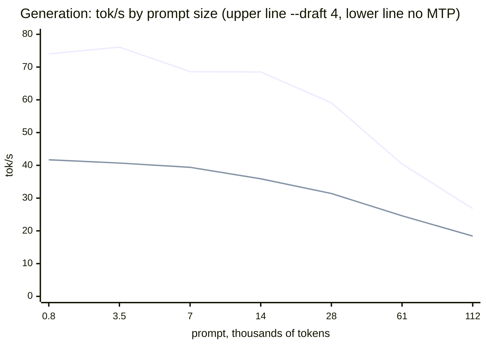
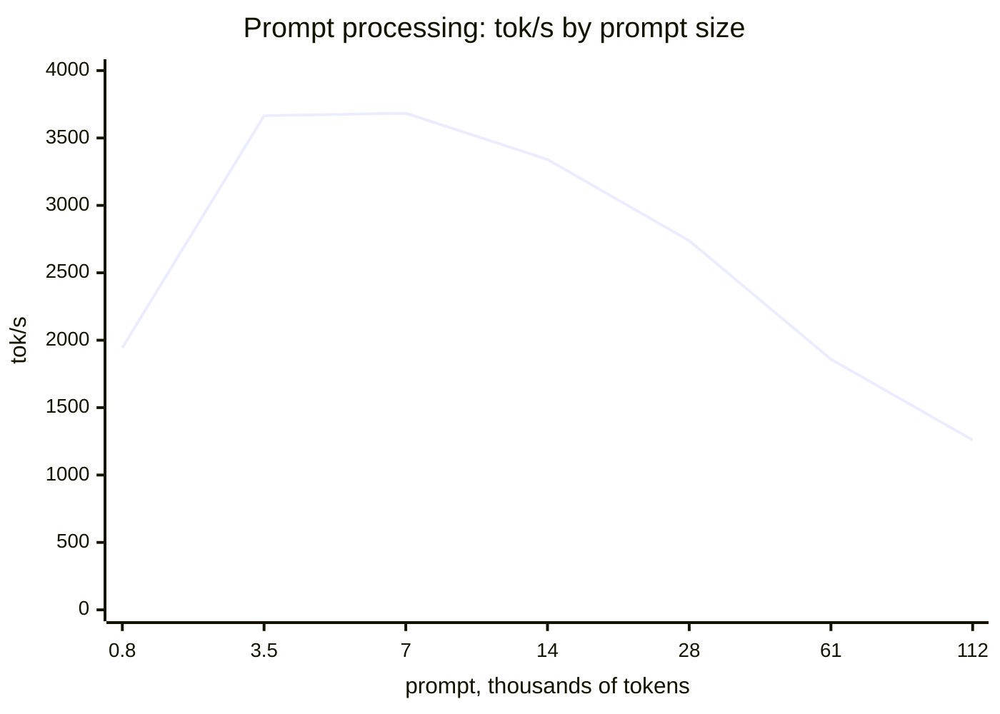
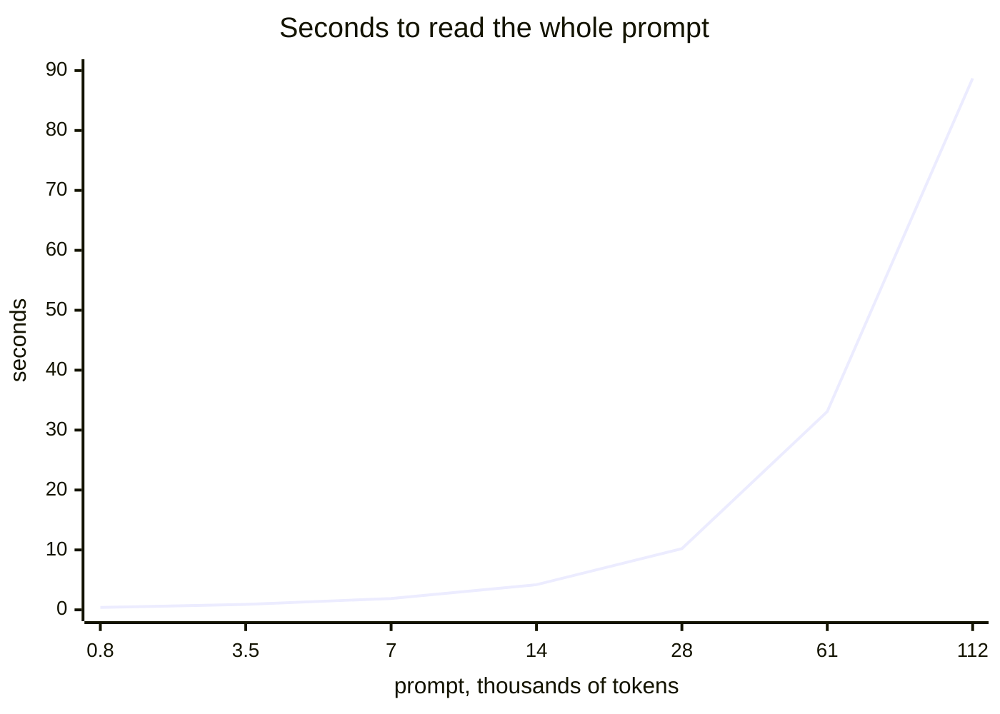

<h1 align="center">airun</h1>

<p align="center">
  <b>Inference engine for <u>Qwen</u> models on NVIDIA GPUs, written from scratch in Rust + CUDA.</b><br>
  No llama.cpp, no ggml, no PyTorch, no cuBLAS: every kernel belongs to this project.
</p>

<p align="center">
  <a href="LICENSE"></a>
  
  
  
</p>

```powershell
airun run   Qwen3.8-27B-NVFP4.gguf -p "Explain what a GPU kernel is"
airun serve Qwen3.8-27B-NVFP4.gguf          # API compatible with llama-server, OpenAI and Anthropic
```

---

## Which models

airun is built for the **Qwen family**. What decides whether a file runs is
the architecture recorded in it (`general.architecture` in the GGUF; `airun
inspect model.gguf` shows it):

| Architecture | Models | Status |
|---|---|---|
| **`qwen35`** | **Dense Qwen3.5 and Qwen3.8** (e.g. Qwen3.8-27B) | **Main focus.** Everything works: MTP, vision, `--parallel`, NVFP4 |
| **`qwen35moe`** | **Qwen3.5 and Qwen3.8 MoE** (e.g. Qwen3.8-35B-A3B) | Complete. MTP exists but is off by default (it is slower on MoE) |
| `qwen4exp` | Qwen4 Flash-Next | Complete, except `--parallel` |
| `qwen3next`, `qwen3nextmoe` | Qwen3-Next | Same block as `qwen35` |
| `qwen3` | Dense Qwen3 (0.6B to 32B) | Complete (these models have no MTP or vision) |
| `qwen2`, `llama` | Models with the same block layout | Work, but lightly tested |
| `qwen3moe` | Qwen3-30B-A3B, Qwen3-235B-A22B | **Not yet** |

Qwen3.5/3.8/Next are **hybrids**: three of every four layers are "delta-net"
(linear attention, with a fixed-size state instead of a growing cache) and one
is regular attention. That is why they handle contexts of hundreds of
thousands of tokens with little VRAM, and it is the architecture airun focuses
its optimizations on.

Other families (Gemma, Llama 3+, Mistral, DeepSeek, GLM…) are **not
supported**: airun refuses the file with a clear message instead of
generating wrong text.

---

## Highlights

- **Faster than llama.cpp** on Qwen3.8-27B NVFP4: in prompt processing, in
  generation, with contexts up to 128k tokens and with speculative decoding
  (MTP). On Qwen4 Flash-Next (78 GB, larger than VRAM) it also beats Strata.
- **MTP: the model drafts the next tokens with the extra head it already
  ships,** and the main model checks several at once. On the 27B generation
  almost doubles (26 → 68 tok/s), with or without temperature. The head can
  come in a separate file (`mtp-*.gguf`, as llama.cpp produces).
- **Vision:** with the model's `mmproj`, it reads images (photos, screenshots,
  pages of text). Works in `run` and in the API.
- **Several people at once** (`serve --parallel N`): each conversation keeps
  its own cache, and the ones generating advance together. With 4 concurrent
  requests the server delivers 2.2 times more tokens.
- **Models larger than VRAM:** fills the main GPU, then the others, and only
  then uses RAM. In a MoE, the least used experts stay in RAM, and the unused
  part of a long KV cache holds more experts until the context reaches it.
- **Same API as `llama-server`:** OpenAI (chat, completions, responses),
  Anthropic (messages), llama.cpp native routes, tool calls, reasoning,
  grammars, JSON schema, embeddings, slots and stream replay. Clients built
  for llama-server work unchanged (56 of 56 cases checked).
- **Verified correctness:** each quantization format exists in Rust (the
  reference) and in CUDA, and `airun selftest` compares the two (more than 280
  cases).
- **One binary, no Python:** loads GGUF, converts safetensors, quantizes,
  measures and serves.

---

## Quick start

### Requirements

- NVIDIA RTX 20, 30, 40 or 50 GPU (compute capability 7.5 or higher)
- CUDA Toolkit 12.x or 13.x (RTX 50 needs 12.8 or newer)
- Rust 1.85 or newer
- Windows: MSVC Build Tools 2022 · Linux: gcc or clang

### Build

```powershell
git clone https://github.com/<you>/airun
cd airun
.\build.ps1      # Windows
./build.sh       # Linux
```

The script finds your GPUs, builds only for them and, at the end, runs the
`selftest` on each to confirm everything is right. Options:

| Windows | Linux | What it does |
|---|---|---|
| `-Arch 120` | `--arch 120` | Builds for a chosen architecture (or several: `86,120`) |
| `-All` | `--all` | Builds for RTX 20 through 50 (to distribute the binary) |
| `-NoGpu` | `--no-gpu` | No CUDA |
| `-Debug` | `--debug` | Debug build |
| `-SkipCheck` | `--skip-check` | Does not run the selftest at the end |

**GPUs of different generations in the same PC** (e.g. RTX 3060 + RTX 5060 Ti)
work: the script builds for both, and each card runs its own code.

To build by hand: `$env:AIRUN_CUDA_ARCHS = "120"` (or `75`, `80`, `86`,
`89`, or a list) and `cargo build --release`.

### Generate text

```powershell
airun run model.gguf -p "What is RoPE?"
airun run model.gguf -p "Solve: 17 x 23" --reasoning-effort low     # thinks briefly
airun run model.gguf --mmproj mmproj.gguf --image photo.jpg -p "What is in the image?"
Get-Content prompt.txt | airun run model.gguf --stats                # prompt from a file, with timings
```

### Serve the API

```powershell
airun serve model.gguf --port 8080 --api-key my-key
```

Open `http://localhost:8080/` for the built-in chat, or use any OpenAI,
Anthropic or llama.cpp client:

```bash
curl http://localhost:8080/v1/chat/completions \
  -H "Authorization: Bearer my-key" -H "Content-Type: application/json" \
  -d '{"messages":[{"role":"user","content":"Hello!"}]}'
```

```python
from openai import OpenAI
client = OpenAI(base_url="http://localhost:8080/v1", api_key="my-key")
r = client.chat.completions.create(model="airun", messages=[{"role": "user", "content": "Hello!"}])
print(r.choices[0].message.content)
```

Without `-c`, airun picks the context: the largest that fits, or, between GPUs
of different speeds, the largest that costs at most 10% of the decode speed
(`--prefer speed|balanced|context` changes that). MTP is off unless you pass
`--draft`; the load tells you when the model has a head and how many drafts
suit it.

---

## Results

Each measurement has a script, raw output and a report in
[`benchmarks/`](benchmarks/). The GPUs in these tests **have no P2P**: what
moves from one card to the other goes through RAM. Numbers in tokens per
second.

### Qwen3.8-27B NVFP4, one GPU (RTX 5070 Ti)

Best of 3 alternated rounds
([`benchmarks/2026-11-01`](benchmarks/2026-11-01/RESULTS.md)):

| Test | airun | llama.cpp b11760 | |
|---|---:|---:|---:|
| 512-token prompt | **3797** | 3472 | +9% |
| 2048-token prompt | **3690** | 3652 | +1% |
| generation | **49.0** | 47.9 | +2% |
| generation with MTP | **113.7** | 104.6 | +9% |

### Speed by context depth (RTX 5070 Ti + RTX 5060 Ti)

Qwen3.8-27B NVFP4, `serve --kv-type q4_0 -c 131072`, prompts of real source
code, 200 tokens generated, one run per point
([`benchmarks/2026-11-12`](benchmarks/2026-11-12/RESULTS.md)). The x axis is
the prompt size in thousands of tokens.







| Prompt tokens | 764 | 3,467 | 6,851 | 14,006 | 27,885 | 61,491 | 111,761 |
|---|---:|---:|---:|---:|---:|---:|---:|
| prompt tok/s | 1944 | 3665 | 3684 | 3341 | 2738 | 1859 | 1260 |
| generation, `--draft 4` | 74.0 | 76.1 | 68.6 | 68.5 | 59.1 | 40.4 | 26.8 |
| generation, no MTP | 41.7 | 40.7 | 39.4 | 35.9 | 31.4 | 24.6 | 18.4 |

- **Generation holds within 10% of its best up to ~14k tokens,** has lost a
  quarter by 28k and two thirds by 112k: every new token reads the whole
  cache.
- **MTP's gain shrinks with depth,** from 1.8-1.9x to 1.5x at 112k.
- **Prompt processing peaks between 3k and 7k tokens** and falls to a third
  by 112k. A chat does not pay it again: the next turn reuses the cache.

### Long context, real code (RTX 5060 Ti + RTX 3060)

The 27B split across both cards, with prompts taken from 1 MB of C++/CUDA
code:

| Test | airun | llama.cpp b11760 | |
|---|---:|---:|---:|
| 8k-token prompt | **1150** | 1079 | +7% |
| 32k prompt | **1039** | 987 | +5% |
| 128k prompt | **745** | 712 | +5% |
| generation at 8k context | **22.4** | 20.1 | +12% |
| generation at 128k context | 13.4 | 13.5 | tie |

A real request (the whole `ggml-cuda.cu` file, 61,634 tokens, plus a question
about it) read the prompt at 899 tok/s and answered at 19.8 tok/s, with 95% of
the MTP drafts accepted. The answer was right.

### Qwen3.8-35B-A3B Q4_K_M on one RTX 3060 12 GB

The ~21 GB MoE does not fit 12 GB: about a fifth of the experts live in RAM
and cross PCIe when routed. `airun serve ... --kv-type q8_0 -b 256 -c 262144`,
average of 5 requests with ~2.3k-token prompts and 400 generated tokens
(i7-13700, 64 GB DDR5, Windows 11):

| | prompt | generation |
|---|---:|---:|
| airun | **553** | **61.0** |

With a short prompt generation reaches 73-75 tok/s.

### Qwen4 Flash-Next (78 GB MoE, larger than both GPUs combined)

792-token prompt, prompt / generation
([`benchmarks/2026-11-01d`](benchmarks/2026-11-01d/RESULTS.md)):

| | airun | Strata 0.1.55 | llama.cpp |
|---|---:|---:|---:|
| prompt / generation | **418 / 40.7** | 316 / 34.4 | 36 / 9.9 |

Experts that do not fit in VRAM stay in RAM; airun brings them over PCIe
while the GPU computes the others.

### When airun loses

When the model **does not fit** in VRAM at all and whole layers stay in RAM
(e.g. the 27B on an 8 GB GPU), airun computes those layers on the CPU with
AVX2 kernels (Q4_K/Q5_K/Q6_K/Q8_0/NVFP4); llama.cpp still has the edge
there. The advantages above hold with the model in VRAM.

---

## The API

Routes, fields and responses follow `llama-server`'s, so its web UI and the
OpenAI and Anthropic SDKs work without adaptation.
[`tests/api_conformance.py`](tests/api_conformance.py) compares the responses
with llama-server's, field by field.

| Route | Purpose |
|---|---|
| `/v1/chat/completions` | OpenAI chat: streaming, tool calls, reasoning, logprobs, JSON output |
| `/v1/responses` | OpenAI Responses API |
| `/v1/messages` | Anthropic Messages API |
| `/v1/completions`, `/completion` | Text completion (OpenAI and llama.cpp's native format) |
| `/infill` | Code completion in the middle of a file (FIM) |
| `/v1/embeddings`, `/embedding` | Embeddings (with `--embeddings`) |
| `/tokenize`, `/detokenize`, `/apply-template` | Utilities |
| `/v1/stream/{id}` | Replay a generation that continued after the client dropped |
| `/slots`, `/health`, `/props`, `/v1/models` | Server state |
| `/hardware` | Live GPU load, VRAM, temperature, power, clocks and PCIe traffic (NVML), plus system, process and pinned RAM; the web UI shows it in the sidebar |

- **Images:** with `--mmproj`, send the image as a data URL (OpenAI) or base64
  (Anthropic).
- **Reasoning:** `reasoning_effort` (`none`, `low`, `medium`, `high`, `max`)
  controls how much the model thinks; `reasoning_budget_tokens` sets the exact
  limit.
- **Sampling:** the same chain as llama.cpp (penalties, DRY, top-k, top-p,
  min-p, XTC, mirostat…), with `seed` and `logit_bias`.
- **Constrained output:** GBNF grammar, JSON schema or `response_format`. On a
  model that thinks before answering, the rule applies only to the answer.

```bash
curl http://localhost:8080/v1/chat/completions -H "Content-Type: application/json" -d '{
  "messages": [{"role": "user", "content": "Make up a person."}],
  "response_format": {"type": "json_schema", "json_schema": {"schema": {
    "type": "object", "properties": {"name": {"type": "string"}, "age": {"type": "integer"}},
    "required": ["name", "age"]}}}}'
```

---

## Formats

| | |
|---|---|
| **Quantizations read** | F32, F16, BF16, Q4_0, Q4_1, Q5_0, Q5_1, Q8_0, Q2_K, Q3_K, Q4_K, Q5_K, Q6_K, IQ2_S, IQ3_XXS, IQ3_S, IQ4_NL, IQ4_XS, MXFP4, NVFP4 |
| **Quantizations written** | F32, F16, BF16, Q4_0, Q4_1, Q5_0, Q5_1, Q8_0, Q4_K, Q5_K, Q6_K, NVFP4 |
| **KV cache** | f16, q8_0, q4_0 (`--kv-type`; q4_0 fits ~3.6x more context) |
| **Input** | GGUF; HuggingFace safetensors via `airun convert` |
| **Vision** | Qwen3.5/3.8 `mmproj` (`qwen3vl_merger` projector) |

**Not yet:** audio, LoRA, rerank, video and the `qwen3moe` architecture.

**NVFP4 from other tools** (vllm, NVIDIA) stores a scale factor in a file next
to each weight (`<name>.scale`). airun reads and applies that factor; without
it, the model generates garbage.

---

## Why it is fast

- **NVFP4 on the FP4 tensor cores** of RTX 50. On earlier cards it runs in
  int8, with the same result (and still ahead of llama.cpp).
- **The Qwen3.5/3.8 delta-net in chunks on the tensor cores** during the
  prompt, instead of token by token (+8% on the prompt).
- **Decode in chained CUDA graphs:** the next step is already queued before
  the processor reads the current token, so the GPU does not wait.
- **MTP**, with or without temperature.
- **Several GPUs working at once on the prompt:** the first card already
  starts the next chunk while the second finishes the current one.
- **MoE experts outside VRAM** are computed in int8 on the GPU, copied with
  few blocks so they do not stall the resident ones, and the hottest migrate
  into VRAM, including into the KV cache's still-unused rows.
- **A VRAM planner** that reads the exact size of each tensor:
  - if the model fits one GPU, it uses only one (crossing PCIe without P2P is
    expensive);
  - if it does not fit and the GPUs differ, it fills the faster one first;
  - if they are equal, it splits evenly (the prompt gets almost twice as fast);
  - if it still does not fit, it lowers batch, context or reserve, and says
    what changed.

---

## How correctness is ensured

A quantization format decoded wrong does not crash the program: it generates
text that *looks* almost right. So:

- **Each format exists twice:** in Rust, simple to read (the reference), and
  in CUDA. `airun selftest` compares the two kernel by kernel.
- **`airun perplexity`** measures the whole model on a known text. It catches
  the subtle errors the selftest does not see.
- **`AIRUN_MATVEC_F32=1 AIRUN_NO_FP4=1`** force the exact f32 computation. On
  the 27B the normal path stays within 0.01 of it (in logprob); llama.cpp is
  0.24 away.

---

## Commands

```
airun run         generate text
airun serve       HTTP server (OpenAI + Anthropic + llama.cpp)
airun bench       measure prompt and generation at several context depths
airun perplexity  measure quality on a known text
airun inspect     describe a GGUF: architecture, tensors, quantization
airun tokenize    see how the tokenizer splits a text
airun convert     safetensors (HuggingFace) -> GGUF
airun quantize    GGUF -> GGUF at another precision
airun gpu         list GPUs, VRAM and P2P
airun selftest    check the GPU kernels against the Rust reference
```

All options: **[docs/FLAGS.md](docs/FLAGS.md)**.

---

## Layout

```
crates/
  airun-gguf/   GGUF and safetensors reading and writing; reference quantization
  airun-cuda/   the CUDA kernels (kernels/*.cu) and the Rust code that calls them
  airun-core/   tokenizer, VRAM planner, runtime, sampling, grammars, MTP, vision
  airun-cli/    the binary: run, serve, bench, perplexity, convert...
tests/          API conformance against llama-server
benchmarks/     every published measurement, with script and raw output
docs/           option reference
```

## Documentation

- **[docs/FLAGS.md](docs/FLAGS.md):** every option of every command.
- **[AGENTS.md](AGENTS.md):** how the code is organized, what has been
  measured and the known pitfalls. Read it before changing anything.
- **[CONTRIBUTING.md](CONTRIBUTING.md):** rules, environment and how to verify
  a change.

## License

[Apache 2.0](LICENSE). The IQ codebooks come from ggml, and the sparse
attention block selection follows Strata's, both under MIT; the notices are in
[NOTICE](NOTICE).
